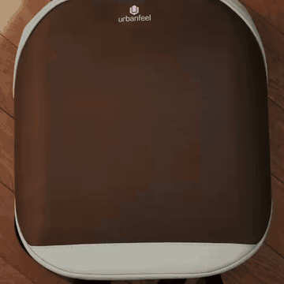
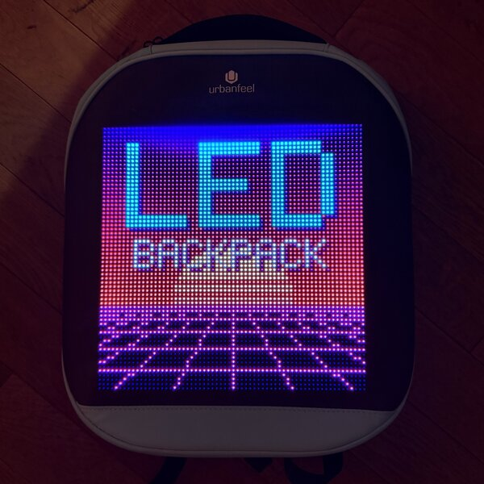

# ysmatrix

[](LICENSE.md)


<p align="center">
  
  
</p>
<p align="center"><sub>Both pictures were generated by <a href="examples/make_demo_images.py">examples/make_demo_images.py</a> and sent with <code>ysmatrix image</code>.</sub></p>

`ysmatrix` is an unofficial Python library and command-line tool for the Bluetooth RGB LED
matrix panels that advertise as `YS…` or `TL…`: 64×64 LED backpacks, bag panels and similar
gadgets that are normally controlled with the *LOY PLAY* / *LOY SPACE* apps. With it you can
put pictures, GIFs, text and clocks on the panel from your own scripts, draw on it live, or play
its built-in games.

The protocol was reverse-engineered from scratch. This README and [docs/status.md](docs/status.md)
say exactly what is proven, what is guessed and what is unknown.

## Features

- 🖼️ **Pictures and GIFs**: stored in one of 60 slots, kept after power-off
- 📝 **Text**: scrolling or static, any colour, rendered by the panel's own font
- ⏰ **Clocks**: a live clock in your own format (`{hh}:{mm}`), or the panel's built-in clock face
- 🔁 **Playlists**: show one slot, or cycle through several
- ✏️ **Live drawing**: rectangles, pixels and bitmaps at up to ~30 fps
- 🎮 **Built-in games**: Tetris and Snake, steered from your keyboard
- ⚙️ **Settings**: power, brightness, rotation, clock sync, device info
- 🐍 **Library**: blocking and asyncio APIs, plus every raw command as a plain function
- 🖥️ **CLI**: `ysmatrix`

## Install

```bash
pip install -e .            # from a checkout (Python 3.10+)
```

On **macOS**, run it from Terminal or iTerm and allow Bluetooth access. Make sure the phone app is
not connected to the panel. See [installation](docs/getting_started/installation.md).

## Quick start: command line

```bash
ysmatrix scan                                 # find panels
ysmatrix info                                 # model, firmware, size, stored slots
ysmatrix brightness 8
ysmatrix image cat.png --slot 1               # pictures and animated GIFs
ysmatrix text "Hello world" --slot 2 -c green # scrolling text
ysmatrix clock --slot 3                       # live hh:mm:ss
ysmatrix loop 1 2 3                           # cycle through slots
ysmatrix game tetris                          # arrow keys, s = start, q = quit
```

More in [docs/getting_started/cli.md](docs/getting_started/cli.md).

## Quick start: Python

```python
from ysmatrix import Client

with Client() as panel:                       # first panel found, or Client("<address>")
    print(panel.get_device_info())
    panel.set_brightness(10)
    panel.send_image("cat.png", slot=1)
    panel.send_text("Hello!", slot=2, color=(0, 255, 0))
    panel.send_clock("{hh}:{mm}", slot=3)
    panel.play_loop([1, 2, 3])

    with panel.drawing():                     # live drawing mode
        panel.fill_rect(8, 8, 55, 55, (255, 128, 0))
```

An `AsyncClient` with the same methods exists for asyncio. See
[docs/getting_started/library.md](docs/getting_started/library.md) and [examples/](examples):
`hello.py`, `slideshow.py` (a folder of pictures as a playlist), `bounce.py` (live animation),
`clock.py`, and `make_demo_images.py` (draws the two demo pictures above).

## Supported devices

Tested on a 64×64 LED backpack (model `EXYB-AS#GGMJXZ180`, firmware `V2.9.1#V16`). Other panels
using the LOY PLAY / LOY SPACE apps are probably compatible; the panel reports its own size. See
[docs/devices.md](docs/devices.md) for how to check yours.

## What works, what doesn't

| | |
|---|---|
| ✅ Proven on hardware | power, brightness, pictures, GIFs, slots and playlists, text, live clock, clock sync, rotation, device info, live drawing, Tetris and Snake |
| 🟡 Partly understood | built-in clock face styles, text scroll speed scale, deleting a slot |
| ❌ Not on the tested firmware | mirror, transitions, built-in light effects |
| ❔ Not done yet | Tetris rotation key, countdown timer, schedules, multi-region layouts, non-ASCII text glyphs |
| ⛔ Left out on purpose | firmware update, password, renaming (risk of locking yourself out) |

The full table, with evidence for every item, is in [docs/status.md](docs/status.md). The wire
protocol is described in [docs/protocol.md](docs/protocol.md).

## Development

```bash
python -m venv .venv && .venv/bin/pip install -e '.[dev]'
.venv/bin/pytest
```

The tests rebuild frames captured from the official app and require them to match byte for
byte, so protocol changes are caught without hardware. To browse the docs as a site:
`pip install -e '.[docs]' && mkdocs serve`.

## Contributing

New evidence is the most useful contribution: a capture of the app doing something not covered
yet, or a test on another panel. See [how this was reverse-engineered](docs/reverse_engineering.md).
Please do not add vendor apps, decompiled code or raw captures to the repository.

## Disclaimer

Not affiliated with or endorsed by the maker of the panels or of the LOY PLAY / LOY SPACE apps.
This project contains no vendor code. Use it at your own risk; no damage was observed on the
test panel, and commands that could lock you out are deliberately not implemented.

## License

MIT. See [LICENSE.md](LICENSE.md).
